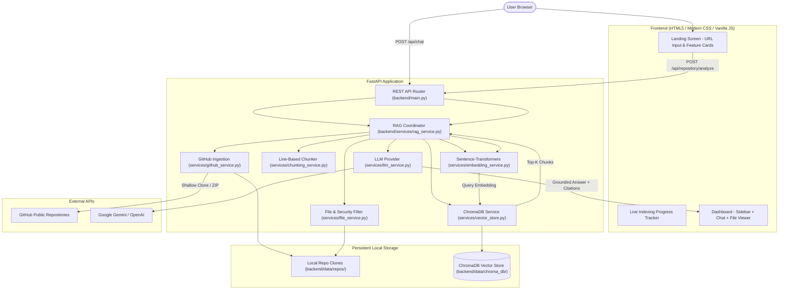

# ◈ CodeLens AI — AI-Powered GitHub Codebase RAG Assistant

> **Production-Quality Final-Year B.Tech Project** in Information Technology & Computer Science  
> *Demonstrating Retrieval-Augmented Generation (RAG), Semantic Vector Search, ChromaDB, Sentence-Transformers, and LLM Code Understanding.*

---

## 📌 1. Project Overview

Understanding an unfamiliar software codebase is one of the most tedious challenges developers face. Manually opening dozens of directories and inspecting hundreds of files to locate authentication routines, database operations, or API lifecycles causes fatigue and wasted time.

**CodeLens AI** solves this problem. A user simply enters any public GitHub repository URL. The system automatically:
1. Clones and scans the repository into an isolated local workspace.
2. Filters useful programming files while ignoring vendor/cache directories (`node_modules`, `.git`, `venv`, etc.).
3. Slices the source code into overlapping line-based chunks while preserving exact start/end line numbers.
4. Generates dense 384-dimensional vector embeddings using a local Sentence-Transformers model (`all-MiniLM-L6-v2`).
5. Persists the embeddings and metadata in **ChromaDB**.
6. Allows users to ask natural-language questions (e.g., *"Where is authentication implemented?"*, *"Explain the API flow"*).
7. Performs cosine similarity retrieval to extract the top-K relevant code chunks.
8. Prompts a Large Language Model (Google Gemini or OpenAI) with a **grounded system prompt** strictly answering from the retrieved code.
9. Displays the explanation alongside **verifiable, clickable source citations** showing the exact files, line numbers, and code snippets.

---

## 🚀 2. Key Features

- **Any Public GitHub Repository**: Analyze repositories instantly via shallow clone or automatic ZIP fallback.
- **Explainable Line-Based Chunking**: Sliding-window chunking (100 lines, 15 overlap) that preserves line numbers and context without complex AST overhead.
- **Local Dense Vector Embeddings**: Utilizes `all-MiniLM-L6-v2` locally on CPU. No external embedding API costs and high throughput on student laptops.
- **ChromaDB Persistent Vector Storage**: Dedicated collection per repository with cosine distance metric.
- **Strictly Grounded LLM Answers**: Eliminates AI hallucination through structured context injection and strict system prompts.
- **Verifiable Source Citations**: Every answer displays exact file paths (`routes/auth.py`), line ranges (`Lines 15–42`), and similarity match scores.
- **Interactive File Explorer & Viewer**: Built-in tree view and code viewer with syntax highlighting (Prism.js) and line counts.
- **Dynamic Suggested Questions**: Automatically analyzes repository language breakdown and suggests relevant questions.
- **Real-Time Indexing Progress**: Live progress bar reflecting actual backend progress across cloning, scanning, chunking, and embedding.
- **Zero-Build Vanilla Frontend**: Modern developer tool SaaS UI crafted with HTML5, CSS3, and JavaScript—zero Node/npm build steps required.

---

## 🏗️ 3. Architecture & Data Flow



---

## 🛠️ 4. Technology Stack

| Component | Technology | Rationale / Viva Defense |
| :--- | :--- | :--- |
| **Backend Framework** | **FastAPI (Python 3.11)** | High-performance asynchronous API framework with automatic Swagger docs and native Pydantic validation. |
| **Vector Database** | **ChromaDB** | Lightweight, open-source embedded vector database that runs in-process without requiring external servers (e.g. Docker or Pinecone). |
| **Embedding Model** | **Sentence-Transformers (`all-MiniLM-L6-v2`)** | 384-dimensional dense vectors; runs in milliseconds on CPU; optimized for semantic sentence/code similarity. |
| **LLM Integration** | **Google Gemini (`gemini-1.5-flash`) / OpenAI** | Fast, high-context LLMs with strict grounding prompts. Configurable via `.env`. |
| **Frontend** | **HTML5, Vanilla CSS3, JavaScript** | Zero npm/node build complexity; easily explainable for university vivas; modern developer tool aesthetic. |
| **Syntax Highlighting** | **Prism.js** | Lightweight, reliable client-side code highlighting for 20+ programming languages. |
| **Testing** | **pytest** | 15 automated unit and end-to-end integration tests. |

---

## 📁 5. Project Directory Structure

```
rag/
├── backend/
│   ├── main.py                  # FastAPI application entry point & static mounting
│   ├── api/
│   │   ├── __init__.py
│   │   ├── repository.py        # /analyze, /status, /files, /file, /clear routes
│   │   └── chat.py              # /chat and /suggested-questions routes
│   ├── services/
│   │   ├── __init__.py
│   │   ├── github_service.py    # URL validation, shallow clone, ZIP fallback
│   │   ├── file_service.py      # Scan directory, filter extensions, path security
│   │   ├── chunking_service.py  # Line-based sliding window with overlap
│   │   ├── embedding_service.py # Sentence-Transformers (all-MiniLM-L6-v2)
│   │   ├── vector_store.py      # ChromaDB collection & cosine similarity query
│   │   ├── rag_service.py       # Central pipeline orchestrator
│   │   └── llm_service.py       # Grounded LLM provider (Gemini / OpenAI / fallback)
│   ├── models/
│   │   ├── __init__.py
│   │   └── schemas.py           # Pydantic request/response data models
│   ├── utils/
│   │   ├── __init__.py
│   │   └── helpers.py           # URL parsing, language mapping, tree builder
│   ├── data/
│   │   ├── repos/               # Cloned repositories cache
│   │   └── chroma_db/           # ChromaDB persistent vector storage
│   └── requirements.txt         # Backend Python dependencies
├── frontend/
│   ├── index.html               # Main single-page application UI
│   ├── css/
│   │   └── style.css            # Modern developer tool styling & dark theme
│   ├── js/
│   │   ├── api.js               # Backend REST API client service
│   │   ├── ui.js                # DOM rendering, file tree, modals, citations
│   │   └── app.js               # Event bindings, polling loop, chat controller
│   └── assets/
├── docs/
│   ├── PRD.md                   # Product Requirements Document
│   ├── ARCHITECTURE.md          # Architectural component specifications
│   ├── RAG_WORKFLOW.md          # Step-by-step RAG pipeline guide
│   ├── API.md                   # REST API documentation
│   └── SETUP.md                 # Step-by-step local setup guide
├── tests/
│   ├── __init__.py
│   ├── test_github_service.py   # URL parsing and validation tests
│   ├── test_file_service.py     # File filtering and traversal protection tests
│   ├── test_chunking.py         # Line-based chunking & overlap tests
│   ├── test_vector_store.py     # ChromaDB vector store unit tests
│   ├── test_api.py              # FastAPI endpoint contracts
│   └── test_full_workflow.py    # Complete end-to-end RAG workflow test
├── .env.example                 # Configuration template
├── .gitignore                   # Git exclusion rules
├── requirements.txt             # Root requirements pointing to dependencies
└── README.md                    # Project documentation
```

---

## ⚡ 6. Quick Start Guide (Windows PowerShell)

### Step 1: Open PowerShell in Project Root
```powershell
cd c:\Users\adity\OneDrive\Desktop\rag
```

### Step 2: Create & Activate Virtual Environment
```powershell
py -3.11 -m venv .venv
.\.venv\Scripts\Activate.ps1
```

### Step 3: Install Dependencies
```powershell
pip install -r requirements.txt
```

### Step 4: Configure Environment Variables
Copy `.env.example` to `.env` and add your Google Gemini or OpenAI API key:
```powershell
Copy-Item .env.example .env
```
Open `.env` in Notepad or VS Code:
```ini
LLM_PROVIDER=gemini
LLM_API_KEY=AIzaSy...your_gemini_api_key_here
```
*(Note: A free API key can be obtained from [Google AI Studio](https://aistudio.google.com/). If left blank, the application operates in an educational fallback mode).*

### Step 5: Start the Application
```powershell
.\.venv\Scripts\python.exe -m uvicorn backend.main:app --reload --host 127.0.0.1 --port 8000
```

### Step 6: Open the Web UI
Open your browser and visit: **[http://127.0.0.1:8000](http://127.0.0.1:8000)**

---

## 🧪 7. Running the Automated Tests

CodeLens AI includes 15 automated unit and end-to-end tests covering all phases:
```powershell
.\.venv\Scripts\pytest.exe -v tests
```
Output:
```
tests/test_api.py::test_health_check_endpoint PASSED
tests/test_api.py::test_repository_status_endpoint PASSED
tests/test_api.py::test_analyze_invalid_url PASSED
tests/test_api.py::test_chat_without_indexed_repository PASSED
tests/test_api.py::test_suggested_questions PASSED
tests/test_chunking.py::test_chunking_small_file PASSED
tests/test_chunking.py::test_chunking_large_file_with_overlap PASSED
tests/test_chunking.py::test_chunking_invalid_parameters PASSED
tests/test_file_service.py::test_file_filtering_and_extraction PASSED
tests/test_file_service.py::test_path_traversal_prevention PASSED
tests/test_full_workflow.py::test_full_rag_workflow PASSED
tests/test_github_service.py::test_parse_valid_github_urls PASSED
tests/test_github_service.py::test_parse_invalid_github_urls PASSED
tests/test_github_service.py::test_github_service_instantiation PASSED
tests/test_vector_store.py::test_vector_store_add_and_query PASSED
======================= 15 passed in 24.09s =======================
```

---

## 💡 8. Example Questions to Try

Once you index a repository (e.g. `pallets/flask` or `psf/requests`):
- *"Where is authentication and request routing implemented?"*
- *"Explain the project architecture and main entry point."*
- *"Which files handle database operations or connection pooling?"*
- *"How does error handling and response formatting work?"*
- *"What third-party packages and dependencies does this project rely on?"*

---

## 🎓 9. B.Tech Viva Questions & Technical Explanations

Here are the most common viva questions external examiners ask and how to answer them:

### Q1: What is RAG and why not just feed the entire codebase into the LLM?
**Answer**: Retrieval-Augmented Generation (RAG) is a technique that combines an information retrieval system (vector database) with a generative model (LLM). Feeding an entire codebase into an LLM is impractical because:
1. Large codebases exceed standard LLM context windows (tokens).
2. Processing millions of input tokens per query is financially expensive and introduces high latency.
3. LLMs suffer from "lost in the middle" problems when context windows are overloaded. RAG extracts only the 3–5 most mathematically relevant chunks, resulting in higher precision and zero hallucinations.

### Q2: Why use Sentence-Transformers instead of TF-IDF or BM25?
**Answer**: TF-IDF and BM25 rely on exact lexical (keyword) matching. If a user asks *"Where is login handled?"* but the code uses `def authenticate_user()`, keyword matching fails completely. Sentence-Transformers maps words into a high-dimensional vector space where semantically similar concepts (like "login" and "authenticate") are positioned close together, enabling true semantic retrieval.

### Q3: Why is line chunking with overlap necessary?
**Answer**: Code constructs such as classes and functions span multiple lines. If we cut chunks strictly at line 100, a function defined on line 95 and ending on line 120 would be severed, corrupting both the vector embedding and the LLM's understanding. An overlap of 15 lines ensures that the function boundary is preserved in full in at least one chunk.

### Q4: Why ChromaDB over PostgreSQL or MongoDB?
**Answer**: ChromaDB is an embedded, specialized vector database optimized for nearest-neighbor similarity search (using HNSW graphs). It runs locally in Python without needing a separate database service, making it lightweight, zero-configuration, and ideal for student and edge deployments.

### Q5: How do you prevent path traversal attacks when viewing repository files?
**Answer**: In `backend/utils/helpers.py`, we implement `sanitize_repo_path()`. It resolves the base repository path and the requested file path using `Path.resolve()`, and verifies that the target file is strictly a child of the base directory via `target.is_relative_to(base)`. Any path containing `../` that attempts to escape the root triggers a `PermissionError` and is rejected with an HTTP 403 Forbidden.

---

## ⚠️ 10. Limitations & Future Scope

### Current Limitations:
- Public GitHub repositories only (private repositories requiring personal access tokens or OAuth are not supported in this version).
- Very large repositories (>5,000 files) may take several minutes to embed on low-power CPUs.

### Future Scope:
- Integration with GitHub OAuth to support private organizational repositories.
- AST-based chunking using Tree-sitter for language-native class and method parsing.
- Interactive call graphs and dependency visualizers using D3.js.
- Multi-repository comparison and Pull Request code review assistant.

---

## 👨‍💻 11. Author & Acknowledgments

- **Project**: AI-Powered GitHub Codebase RAG Assistant (CodeLens AI)
- **Degree**: Bachelor of Technology (B.Tech) in Information Technology
- **Supervision**: Department of Information Technology & Computer Science
- **Libraries Used**: FastAPI, ChromaDB, Sentence-Transformers, Google Gemini, OpenAI, Prism.js.
