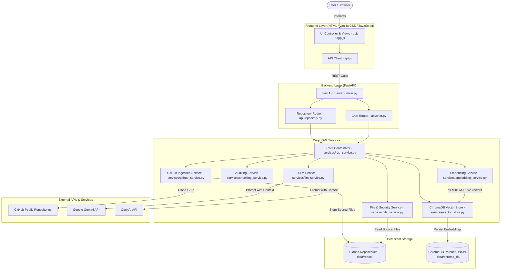

# System Architecture Document

## 1. High-Level Architectural Diagram



---

## 2. Layered Component Responsibilities

### 2.1 Frontend Layer
- **`index.html`**: Semantic single-page application structure. Contains the Landing view (hero, URL input, feature highlights, live progress tracking) and the Workspace dashboard view (collapsible sidebar, file explorer, language stats, chat interface, code viewer, and modals).
- **`css/style.css`**: Professional developer-focused styling inspired by modern dev platforms (Linear, Supabase, Vercel). Features dark slate theme, responsive sidebar drawer, accessible contrast, and smooth transitions.
- **`js/api.js`**: Lightweight, dependency-free HTTP client handling all asynchronous REST communications with the backend endpoints.
- **`js/ui.js`**: View state management, real-time progress bar animations, markdown/code rendering, hierarchical file tree rendering, and modal controllers.
- **`js/app.js`**: Main event bus binding UI interactions, indexing polling loops, natural language query submissions, and keyboard shortcuts.

### 2.2 API & Routing Layer
- **`backend/main.py`**: Application bootstrap configuring FastAPI, CORS middleware, API route mounting, health checks, and static frontend file serving at `/`.
- **`backend/api/repository.py`**: Endpoints for repository ingestion (`/api/repository/analyze`), live indexing status polling (`/api/repository/status`), hierarchical file tree navigation (`/api/repository/files`), and safe file content retrieval (`/api/repository/file`).
- **`backend/api/chat.py`**: Endpoints for RAG-powered question answering (`/api/chat`) and dynamic codebase question suggestions (`/api/chat/suggested-questions`).

### 2.3 Service Layer
- **`GitHubService` (`services/github_service.py`)**:
  - Validates GitHub URL syntax.
  - Verifies public availability via HTTP HEAD checks.
  - Executes shallow Git clones (`--depth 1`) for high speed and minimal bandwidth.
  - Automatically falls back to downloading and extracting the GitHub archive ZIP if Git is absent.
  - Detects local cache to avoid duplicate downloading.
- **`FileService` (`services/file_service.py`)**:
  - Traverses the cloned repository while pruning ignored directories (`.git`, `node_modules`, `venv`, etc.).
  - Filters supported source and documentation file extensions.
  - Enforces maximum file size limit (default 300KB) and excludes binary files.
  - Extracts text content with UTF-8/latin-1 fallback.
  - Provides safe file reading with path traversal verification.
- **`ChunkingService` (`services/chunking_service.py`)**:
  - Slices code into overlapping line-based windows (default 100 lines, 15 lines overlap).
  - Preserves exact 1-indexed start and end line numbers and chunk indices.
  - Attaches contextual headers (`# File: ... | Lines: ...`) to every chunk for optimal semantic embedding.
- **`EmbeddingService` (`services/embedding_service.py`)**:
  - Manages dense vector generation using `sentence-transformers/all-MiniLM-L6-v2`.
  - Lazy-loads the model on first demand to keep startup instantaneous.
  - Computes normalized 384-dimensional dense vectors in mini-batches.
- **`VectorStoreService` (`services/vector_store.py`)**:
  - Encapsulates local ChromaDB operations via `PersistentClient`.
  - Generates isolated collection names per repository.
  - Indexes chunks in batches of 500 with cosine distance metrics.
  - Executes similarity queries returning chunks with cosine similarity scores.
- **`LLMService` (`services/llm_service.py`)**:
  - Abstracted provider layer supporting Google Gemini (`gemini-1.5-flash`) and OpenAI (`gpt-4o-mini`).
  - System prompt enforcing strict codebase grounding.
  - Includes an educational fallback for running offline demonstrations prior to configuring API keys.
- **`RAGService` (`services/rag_service.py`)**:
  - Central orchestrator coordinating ingestion, chunking, embedding, vector storage, and generation.
  - Tracks live progress percentages and step messages for frontend polling.

---

## 3. Data Flow

### Ingestion Flow:
```
GitHub URL -> Validate URL -> Shallow Clone -> Scan Directory -> 
Filter Non-code/Binaries -> Extract Content -> Sliding Line Chunks -> 
Sentence-Transformers (384-dim) -> ChromaDB Collection -> Ingestion Complete (100%)
```

### Retrieval & Answering Flow:
```
User Question -> Sentence-Transformers Embedding -> ChromaDB Cosine Search -> 
Top-K Chunks Retrieved -> Prompt Construction with File Metadata -> 
LLM Inference (Gemini/OpenAI) -> Response Formatted with Source Citations -> UI Display
```

---

## 4. Security Architecture
1. **Zero Execution Policy**: The application strictly reads source code and documentation. It never compiles, imports, or executes code from analyzed repositories.
2. **Directory Traversal Protection**: All file read requests are validated via `sanitize_repo_path()` to ensure target filepaths cannot escape the repository's root boundary.
3. **API Key Isolation**: All LLM credentials reside securely on the backend in `.env` and are never exposed across HTTP or client bundles.
