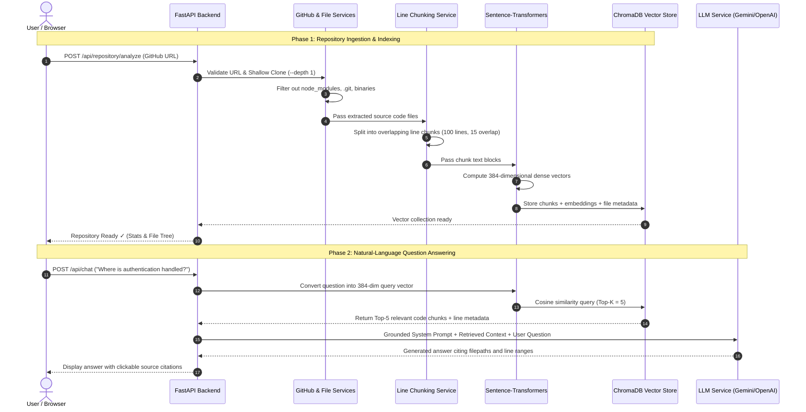

# RAG Workflow Guide

## What is Retrieval-Augmented Generation (RAG)?
Retrieval-Augmented Generation (RAG) is an AI architectural pattern that enhances the output of Large Language Models (LLMs) by retrieving relevant factual information from an external knowledge source—in our case, a GitHub software repository—before generating a response.

### Why use RAG for Codebases?
1. **Context Window Limitations**: Modern codebases often exceed hundreds of thousands of tokens, which cannot fit into an LLM's context window cost-effectively.
2. **Elimination of Hallucinations**: Standard LLMs have a cutoff date and do not know about your specific code repository. RAG grounds the model in the actual code snippets retrieved from your repo.
3. **Traceability & Verification**: Every answer is directly linked to the exact files and lines of code used to produce it.

---

## 1. End-to-End Workflow Diagram



---

## 2. Ingestion Pipeline Explained (Step-by-Step)

### Step 1: URL Validation & Ingestion
- The user provides a URL such as `https://github.com/psf/requests`.
- The system checks URL syntax and verifies that the repository is public using an HTTP HEAD check.
- A shallow Git clone (`git clone --depth 1`) downloads only the latest commit, minimizing disk usage and network transfer. If Git is not installed, an automated ZIP archive download takes over.

### Step 2: File Filtering & Exclusion
Not all files in a repository are useful for understanding code logic. The application applies strict filtering:
- **Included**: Programming and configuration files (`.py`, `.js`, `.ts`, `.java`, `.cpp`, `.c`, `.html`, `.css`, `.md`, `.json`, `.yaml`, `.sql`, etc.).
- **Excluded**: Build artifacts, dependency caches, and version control directories:
  `node_modules`, `.git`, `venv`, `dist`, `build`, `__pycache__`, `.idea`, etc.
- **Binaries Excluded**: Images, executables, compiled archives, and files with null bytes (`\x00`).
- **File Size Cap**: Files over 300KB are excluded to avoid memory bloat.

### Step 3: Overlapping Line-Based Chunking
Why not split by characters or arbitrary tokens?
- Software code is organized logically by lines (classes, functions, decorators, loops).
- **Line Window**: 100 lines per chunk.
- **Overlap**: 15 lines between adjacent chunks.
- **Why Overlap Matters**: If a critical function begins on line 95 and ends on line 120, a hard cut at line 100 would split the function in half. Overlapping ensures that the complete function signature and body remain intact in at least one chunk.
- **Context Header**: Each chunk is prepended with a header:
  ```python
  # File: src/auth/jwt.py | Lines: 1-100 | Language: Python
  ```
  This guarantees that even isolated code snippets retain their file context.

### Step 4: Dense Vector Embeddings
- The system uses `sentence-transformers/all-MiniLM-L6-v2`.
- Transforms text into a 384-dimensional dense vector representing semantic meaning rather than mere keyword occurrences.
- Computations run locally on CPU, ensuring privacy and eliminating external embedding API costs.

### Step 5: ChromaDB Persistent Storage
- Vectors, chunk text, and metadata (repository name, file path, file name, language, start line, end line, chunk index) are committed to a persistent ChromaDB database on disk.
- Each repository is isolated into its own dedicated collection.

---

## 3. Retrieval & Answering Pipeline Explained

### Step 1: Query Embedding
- When a user asks: *"Where is the user login endpoint defined?"*
- The query string is passed through `all-MiniLM-L6-v2` to produce a 384-dimensional query vector.

### Step 2: Cosine Similarity Search
- ChromaDB evaluates the cosine distance between the query vector and all stored chunk vectors:
  $$\text{Cosine Similarity} = \frac{\mathbf{A} \cdot \mathbf{B}}{\|\mathbf{A}\| \|\mathbf{B}\|}$$
- The top-5 chunks with the highest cosine similarity are retrieved along with their metadata.

### Step 3: Prompt Construction & Grounding
The retrieved chunks are assembled into a context block with explicit source identifiers:
```
[Source Chunk #1 | File: routes/auth.py | Lines: 15-45]
... code lines ...

[Source Chunk #2 | File: services/auth_service.py | Lines: 8-32]
... code lines ...
```

The system prompt strictly instructs the LLM:
> *"You are a codebase analysis assistant. Answer the user's question using the repository context provided to you. Do not invent files, functions, classes or implementation details that are not supported by the retrieved context. If the provided context is insufficient, clearly state that the repository context does not contain enough information."*

### Step 4: Answer & Clickable Citations
- The LLM generates the response.
- The UI renders the response with syntax-highlighted code blocks and clickable source badges:
  `📄 routes/auth.py (Lines 15–45) [Score: 88%]`
- Clicking a citation opens a modal previewing the exact code chunk or jumps directly to the full file viewer.
